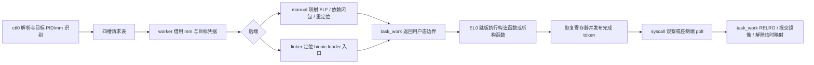

# KCLF 1.6.4 源码审计与设备验证

审计日期：2026-11-27（Asia/Shanghai）。范围为 `kpms/kclf` 中的控制器、准备
worker、ELF/manual、linker、兼容层、AArch64 codegen/TLS 及自带测试工具。
开始时该目录是独立 Git 仓库，已有大量未提交的 1.6.3 变更；本次保留这些变更，
没有修改外围 KernelPatch loader。审计前源码和 KPM 另存于
`build/audit-20261127/source-before.zip` / `kclf-before.kpm`。

## 结论

这是有界 ELF 加载器和内核调度结合的工程实现，模块划分、错误边界、编译约束和
已有测试基础较好；但 1.6.3 新引入的 worker 路径没有被原有单元测试充分覆盖，存在
mm 引用重复释放、请求槽提前复用、取消与状态发布竞争等高影响问题。因此不能把
“原有 15 组测试全绿”解释为并发可靠性已经得到保证。

本轮修复确定问题并构建 1.6.4，扩展到 16 组主机测试及真实测试 App 回归。
在当前 Pixel 6 / Android 16 / Linux 6.1.134 / ARM64 / 4 KiB 页上，正常和
无 BTF/nofault 回退构建均可工作。它仍然是**有使用前提的注入框架**：任意线程位置
的无损恢复、完整 bionic/JNI/TLS 语义和所有 Android 内核的兼容性均未得到保证。

## 实现路径

- `kclf.c` 管理字符串控制协议、四个请求槽、PID/mm 身份、worker、task_work
  引用、取消/排空与完成观察。`pending` 只统计 task_work；worker 有单独所有权。
- `kclf_exec.c` 提供用户内存访问、VMA 枚举、bionic 符号定位、临时映射、返回边界
  检查、pt_regs 改写与回收。nofault 用于不能缺页的 syscall 回调，GUP 用于可睡眠路径。
- `kclf_manual.c` 管理 32 个驻留镜像，按进程和 mm 绑定所有权，读取 ELF，建立映射，
  从已加载 provider 的 DT_NEEDED 闭包解析依赖；不会自动加载或为依赖增加 linker 引用。
  ELF 元数据优先来自文件，无法重开时使用 resident-only 解析。
- `kclf_elf.c` 是可主机测试的有界 ELF64/AArch64 解析器，支持 SysV/GNU hash、版本符号、
  RELA/RELR/APS2 和部分 TLSDESC；IFUNC 延迟到 EL0，拒绝不支持的重定位和几何布局。
- `kclf_codegen.c` 生成跳板，保存/恢复基础 FPSIMD、FPCR/FPSR、NZCV 和除 x16 外的
  通用寄存器。`kclf_tls.S` 实现 payload 本地 TLS，相关镜像采用 NODELETE 生命周期。
- `kclf_compat.c` 使用运行时符号和 BTF 验证布局，缺失时采用 accessor/procfs 等
  回退；页大小来自 TCR_EL1。并非仅按版本号套用 VMA 结构体。

## 已修复的问题

| 严重程度 | 1.6.3 的问题及触发条件 | 1.6.4 处理及验证 |
| --- | --- | --- |
| 高 | 创建 worker 失败时，`kclf_release_prep_refs()` 已 mmput，调用者又 mmput_async，同一 get_task_mm 引用释放两次 | `worker_submit` 负责所有返回路径的准备引用；故障测试验证每项恰好释放一次 |
| 高 | slot/reap 只检查 task_work pending；worker 尚在处理或释放引用时，控制器可 reset/复用槽位 | worker 最后一次访问才 release-store 阶段；回收、诊断、重复目标检查均考虑 worker 所有权 |
| 高 | cancel/quiesce 无条件覆盖 ARMED/PREPARING，可能撞上 READY 发布或 callback 排队；准备代码又提前清除 worker_phase | 只认领 queued 阶段再取消；执行中的准备返回 EBUSY；quiesce 保留当前所有者，READY 先移除 callback 再回滚 |
| 高 | 回滚先读 task->mm 再 get_task_mm；中间 exec 可让实际引用指向新的 mm | 对实际取得的 mm 引用再次比对，绝不向替换 mm 执行回滚；模拟 exec 交错覆盖 |
| 中 | 无 BTF 时 worker 的 get_task_mm(current) 因 PF_KTHREAD 返回 NULL，准备直接失败 | worker accessor 返回自己已持有的借用 mm；主机回归与关闭 BTF/nofault 的设备回归覆盖 |
| 中 | worker 能力检测未要求 get_task_cred/access_remote_vm，可能使用错误凭据或不可用的内存访问路径 | 缺任一接口则禁用 worker，沿既有目标线程路径准备 |
| 中 | provider 打开成功后，长度不足/llseek 失败跳到清理路径，但 file 尚未转交 view，导致 fput 漏掉 | filp_open 成功立即记录所有权；新增空文件、短文件和 llseek 失败断言 |
| 中 | worker 总从槽 0 取请求，低槽阻塞者不断重试会饿死后槽；同路径比较又跨进程阻塞，而同进程不同 SO 的互斥未计入 | 四槽轮询；按 mm/manual 事务排队，包含 release；等待前检查目标死亡，尽早释放 mm |

主机新增用例在修复前分别复现了槽位提前回收、no-BTF mm 和 provider 文件引用错误，
失败证据在 `build/audit-20261127/before-*.log`。新 worker suite 直接抽取生产函数，
注入线程创建失败、准备失败、回滚失败、队列拒绝、取消/完成/exec 交错；不是独立重写状态机。
这些模拟是回归证据，并非对真实 SMP 内存模型或全部内核调度的形式化证明。

设备新增测试发现 manual registry 本身按同 mm 串行，而旧排队只看路径；1.6.4 使两者一致。
失败探索保留在 `build/kclf-app-9a1a109e66d6`，不计为通过测试。

## 效率评价

较好的部分：prepare 从目标返回边界移到专用 worker；provider 权限快照一次获取、二分查找；
符号解析有缓存、hash 查找和读取预算；provider 表按需扩容；完成观察仅匹配最多四槽并使用
nofault，昂贵处理留在可睡眠路径。编译后的最终 KPM text/data/bss 为
95,493 / 88 / 52,752 字节（不等于注入时的动态峰值）。

仍有成本：每次新镜像准备要枚举目标 VMA、打开并解析多个 provider；大 App 的开销随映射/
依赖数量上升。当前挂 70 个 syscall 观察点，空闲时也有 hook 分派成本；本轮没有测量全机
syscall 吞吐损失。worker 启动后以 20 ms 空闲轮询，约每秒 50 次定时唤醒；忙请求每次
重试带 5 ms sleep，2000 次是尝试上限，不是严格的墙钟超时。未将这些耗时伪装成零开销。

本次 `benchmark.py` 在已安装的普通测试 App 上，各后端预热 1 次，再串行加载/卸载 20 次：

| 后端 | 样本数 | 最小 | 中位数 | P95（nearest rank） | 最大 |
| --- | ---: | ---: | ---: | ---: | ---: |
| manual | 20 | 124.50 ms | 191.41 ms | 210.02 ms | 226.18 ms |
| linker | 20 | 60.94 ms | 134.89 ms | 187.33 ms | 189.03 ms |

测量从发送 inject 到 status 确认完成且资源已排空，**包含 ADB 启动、通信、查询和 10 ms
轮询等待**，不能作为纯内核加载延迟，也没有用于声称相对 1.6.3 快多少。原始样本在
`build/audit-20261127/benchmark.json`。阻塞 manual 请求存在时的独立 linker 请求
136 ms 内完成，证明轮询调度允许独立请求进展；这是调度行为验证，不是通用性能承诺。

## 代码规范评价

- Makefile 已启用 `-Wall -Wextra -Werror -Wformat=2 -Wshadow`、2048 字节栈帧告警、
  `-mgeneral-regs-only -ffixed-x18 -mno-outline-atomics`，避免内核侧误用 SIMD、x18 或
  引入不在 KPM ABI 中的原子运行库；本轮构建无告警。导入检查没有发现新增宿主依赖。
- ELF 边界、字符串预算、映射所有权、错误码、前向拒绝策略和模块分层有明确设计。
  已有 GPL SPDX、主机 sanitizer 测试和可复现 App 工具，是良好基础。
- 约 1800 行的控制文件同时承载控制协议、调度与卸载策略，阶段曾使用 0/1/2/3/4/5
  魔数；`volatile` 和原子访问混用、部分历史注释依旧围绕旧执行模型，维护成本偏高。
  本轮优先修正所有权和注释，未做大规模格式化/文件拆分，以减少验证范围外的风险。
- 主机 suite 抽取生产函数，但部分使用简化 mock 结构，可能遗漏跨函数/跨 CPU 关系；
  本轮 worker suite 使用生产请求结构并补充确定的调度交错。设备压力测试仍不是全覆盖。
- 测试 runner 现在对取消忙作有界重试，并等待 reap 完成，避免把“取消已接受”误当成
  “映射已经回收”。未将 superkey 写入源码或审计记录。

## 剩余可靠性与兼容性边界

1. **高：x16 恢复限制。** 跳板最终用 `RET x16` 返回，x16 被原 PC 覆盖；syscall
   白名单不能证明该寄存器在任意被打断位置已经死亡，也不能证明线程未持锁。
   AAPCS64 的 IP0 临时寄存器约定针对调用边界，不等于任意异步中断位置可破坏。
   这来自代码和 ABI 的共同推断；见 [Arm AAPCS64](https://github.com/ARM-software/abi-aa/blob/main/aapcs64/aapcs64.rst)。
   本轮未改变恢复协议，调用方仍需选择协作安全点。
2. **高：provider 生命周期与身份。** manual 未持 bionic loader 锁、未增加依赖引用；
   并发 dlclose/munmap 会使已解析地址失效。文件后备 view 依据路径重开，未将新文件 inode
   与映射 inode 绑定；升级替换文件可能导致元数据与驻留代码不一致。必须保持依赖驻留及
   文件身份稳定；需要另行设计文件引用/身份传递，不能用路径相同当作身份相同。
3. **中：TLS/JNI/C++ 与栈。** 仅 payload 本地 TLSDESC、基础 FPSIMD 有明确支持，
   SVE/SME、完整 bionic TLS/soinfo、通用 JNI 加载流程等不支持。NODELETE 镜像驻留至 mm
   退出；unload 不等待 payload 后台线程/异步回调。4K 页设备临时栈约 24–56 KiB，再扣
   256 字节余量，复杂构造函数需评估栈耗用；有 guard 并不意味着不会栈溢出。
4. **中：运行时 ABI 并非全面探测。** BTF 检测 pt_regs、mm/VMA 布局和 task_work ABI
   优于硬编码偏移，但 TIF 宏、部分 GUP flags、未验证的动态函数原型仍有版本/厂商假设。
   直接查 kallsyms 使用的是内核内部接口，不能把 GKI KMI 稳定性扩展成这些符号的保证。
   Android 的 KMI 按分支/代际定义，参见 [AOSP common kernels](https://source.android.com/docs/core/architecture/kernel/android-common)。
5. **中：宿主与卸载。** KPM 依赖宿主提供正确的栈/线程布局、syscall hook 和回调生命周期。
   当前工作区 loader 有保留 exit 失败模块的改动，但设备是否采用完全相同 loader、旧宿主
   ctl0 是否持 RCU，不可仅从模块测试推定。使用 `quiesce=idle` 后卸载；本轮每次均先排空。
   `task_work_cancel` 返回未移除时也不能视作已取消，参见 [ACK task_work 实现](https://android.googlesource.com/kernel/common/+/refs/tags/android14-6.1-2024-07_r4/kernel/task_work.c)。
6. **失败保留策略。** munmap/RELRO 持续失败会保留映射或镜像所有权以避免误卸载 live code，
   部分情况需目标进程退出后 reap。目标线程单独退出而整个 mm 仍存活也可能留下需要排查
   的映射；本轮没有证明所有线程退出组合均能立即回收。PID/mm 身份与引用覆盖了常用路径，
   不应据此声称不存在泄漏。

| 兼容维度 | 已验证 | 未验证/结论 |
| --- | --- | --- |
| 当前设备 | Pixel 6，Android 16，6.1.134，ARM64，4K | 普通 App、manual/linker/TLS 与清理流程通过 |
| BTF/nofault 缺失 | 同一设备独立禁用两能力的构建 | 覆盖回退逻辑，不代表真实旧内核的其他 ABI |
| 内核版本标签 | 5.0 至 6.18 的模拟 notify/TIF/cancel 选择 | 未启动其他版本/厂商内核，不能认证全面 5.x/6.x 兼容 |
| 页大小 | 4K 实机；4K/16K/64K 主机 codegen/TLS 用例 | 16K/64K 真机及不同 VA/配置尚未验证 |
| 错误处理 | ASan/UBSan 注入已列举失败与调度交错 | 非内核 KASAN/KCSAN、非长期 SMP 压力或形式化验证 |

## 本轮证据与产物

最终 `kclf.kpm` SHA-256：
`56599D4ACBDB1F0B469E356BBAAF547E2A458598130230134751CE8FCF948560`。

关闭 BTF/nofault 的独立构建 SHA-256：
`D56D276E208B414F58AF5BB91CB4E66D4E4857C220D6C1A9E02FA10C771ACE68`。

测试 APK 本轮使用 SDK android-36/build-tools 36.0.0、NDK 27.0.12077973 重新编译，
SHA-256：`4BAC842F55CF39F3FECB53128BF6CDF880C9C5439A5AC712DB9C1DD88B79CF76`。
TLS native fixtures 同样重新编译。KPM 使用 WSL Ubuntu 24.04 / AArch64 GCC 13，
Makefile 的严格告警选项全部启用。

| 检查 | 结果 | 证据目录/文件 |
| --- | --- | --- |
| 1.6.3 baseline manual，Repeat 3 | 181 项断言通过 | `build/kclf-app-10c01e8df057/results.txt` |
| 主机 16 suites | ASan/UBSan 通过，含 codegen 4K/16K/64K | `build/audit-20261127/host-final.log` |
| 实机导出 BTF | 布局/缺符号回退/mm 引用平衡通过 | `build/audit-20261127/real-btf.log` |
| 最终 manual，Repeat 10 | 273 项通过，含快速取消与跨后端公平性 | `build/kclf-app-a79ecc1d2d45/results.txt` |
| 最终 linker，Repeat 10 | 251 项通过 | `build/kclf-app-32af4ef6936e/results.txt` |
| 回退 manual，Repeat 5 | 227 项通过，done=poll | `build/kclf-app-668706db5596/results.txt` |
| 最终 TLS，Repeat 3 | 93 项通过 | `build/kclf-tls-c87d86703129/results.json` |
| 回退 TLS，Repeat 3 | 106 项通过 | `build/kclf-tls-378d39dc36ce/results.json` |
| 最终 benchmark | manual/linker 各 20 样本完成、进程存活 | `build/audit-20261127/benchmark.json` |

每次 App 测试均检查 marker 在指定线程执行、进程未被替换、映射权限/回收、正常/失败
路径、FP 恢复、排队/重复/满槽/取消、进程退出、quiesce 与模块 reload。保留的 dmesg/
logcat 中无本轮新增测试 App 致命崩溃或内核 BUG/WARNING/Oops/panic；boot ID 与 SELinux
模式保持不变。日志缓冲检查不等于任意时间窗口的完整内核证明。

本轮未对仓库历史报告中的商业 App 或其他设备重复测试。历史兼容报告不是本轮证据。
审计完成时源码优化、诊断测试和产物保留在工作区；发布状态以
[GitHub Releases](https://github.com/AndroidReverser-Test/KCLF/releases) 为准。
仅本轮四个生产源码文件的差异另存于 `build/audit-20261127/source-changes.patch`，
产物指纹在同目录 `manifest.json`。最终检查 KPM 列表为空，测试 App 已停止，APK 保留。
